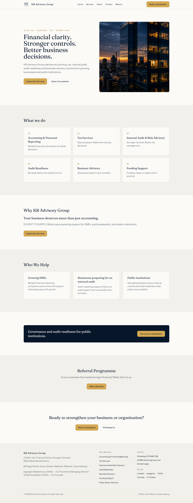
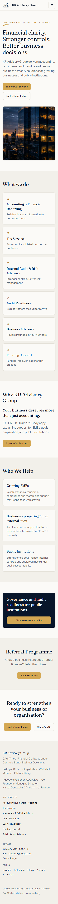
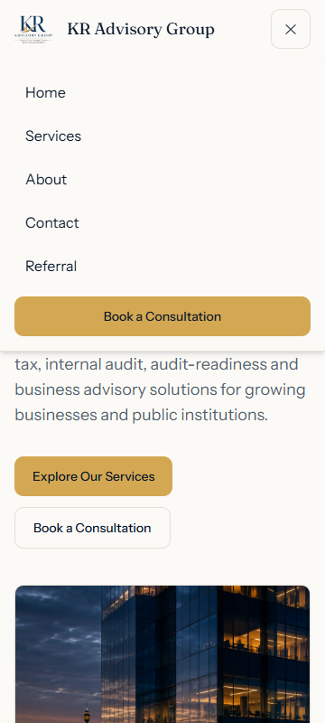
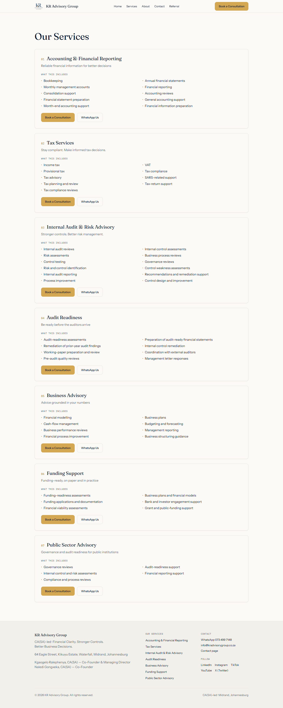

# Visual QA — Phase 2.5 — KR Advisory Group

**Date:** 10 October 2026
**Scope:** Live, rendered visual verification of the Phase 2 rebuild before Phase 3.
**Method:** Production build (`npm run build`, `vite-react-ssg`) served statically with `sirv`, then driven headless through **Microsoft Edge (Chromium)** via `playwright-core`. Screenshots and layout diagnostics were captured for all 5 pages at all 6 required viewports (30 full-page screenshots + 1 mobile-menu state = 31 images in `qa-screenshots/`).

> Why this phase mattered: the Phase 2 build passed every *static-HTML* check, but rendering the pages in a real browser revealed a **critical hydration defect that blanked the Home page** — invisible to grep-based checks. This is the value of a visual pass.

---

## 1. What was tested

**Pages:** Home (`/`), Services (`/services`), About (`/about`), Contact (`/contact`), Referral (`/referral`).
**Viewports:** 360, 390, 768, 1024, 1440, 1920 px.

**Checked per combination (programmatic + visual):** logo rendering, header, footer, primary navigation, mobile navigation (toggle + open panel), typography (Fraunces display / Instrument Sans body / IBM Plex Mono labels), spacing, service cards, CTAs (incl. WhatsApp), horizontal overflow (`scrollWidth` vs `clientWidth`), exactly one H1 per page, and failed network requests (console/404s).

---

## 2. Issues found

### 2.1 CRITICAL — Home page blanked after hydration (fixed)
- **Symptom:** On the live/served build, every viewport of **Home** rendered an "Unexpected Application Error!" state — `header`, `footer`, and `h1` all absent; the server-rendered content was replaced by a React Router error-boundary `<pre>` showing `SyntaxError: Unexpected end of JSON input`. Other pages hydrated but still carried the same underlying fault.
- **Root cause:** `vite-react-ssg`'s client runtime fetches `static-loader-data-manifest-${window.__VITE_REACT_SSG_HASH__}.json`. The build was configured with `ssgOptions.script: 'async'`, so the app module could execute **before** the inline script that defines `window.__VITE_REACT_SSG_HASH__`. The hash read back as `undefined`, so the client requested `static-loader-data-manifest-undefined.json` → **404** → empty body → `Response.json()` threw → the router error boundary wiped the page.
- **Verification of cause:** captured the exact console error, the failing request URL (`.../static-loader-data-manifest-undefined.json`), and the error `<pre>` text from the live DOM.

### 2.2 Horizontal overflow on Home at 360 / 390 px (fixed)
- **Symptom:** `scrollWidth = 690px` against a 360/390px viewport — a ~330px horizontal scroll.
- **Root cause:** this was a secondary effect of 2.1 — the error-boundary `<pre>` printed a long, non-wrapping stack trace that forced the document wide. Resolved by fixing 2.1.

### 2.3 Horizontal overflow (2px) at 768 px on all pages (fixed)
- **Symptom:** `scrollWidth = 770px` at the 768px viewport on every page.
- **Root cause (two parts):**
  1. The desktop nav was revealed at the `md` breakpoint (768px); logo + 5 links + CTA measured 770px, spilling 2px at exactly 768px.
  2. After moving the nav breakpoint, the residual spill traced to the **footer email link** `info@kradvisorygroup.co.za` — a long unbroken token that rendered 176px wide and pushed 2px past its 150px list cell.

### 2.4 Benign 404 observed and eliminated
- A stale `app-*.js` 404 appeared once due to the static server caching an old build; confirmed the referenced chunk actually exists and matches the HTML. Eliminated by restarting the server against the fresh `dist/`. No code issue.

---

## 3. Issues fixed

| # | Fix | File(s) |
|---|-----|---------|
| 2.1 | Changed `ssgOptions.script` from `'async'` to **`'defer'`** so the app module executes after the inline hash-setter script, so `__VITE_REACT_SSG_HASH__` is defined before the loader-data manifest fetch. Reverted a temporary `useLegacyRender` experiment once the real root cause was found. | `vite.config.ts`, `src/main.tsx` |
| 2.3(1) | Moved the primary-nav reveal from `md:` (768px) to **`lg:`** (1024px); the mobile menu now serves the full tablet range (768–1023px), removing the nav spill and improving tablet UX. | `src/components/layout/Header.tsx`, `src/components/layout/MobileNav.tsx` |
| 2.3(2) | Added `break-words` to the footer and Contact email links so long email addresses wrap instead of overflowing. | `src/components/layout/Footer.tsx`, `src/pages/Contact.tsx` |

### Post-fix verification (final build, re-rendered in Edge)
- **30 / 30** route×viewport combos: **zero horizontal overflow**.
- **30 / 30**: header present, footer present, exactly one H1, logo rendered.
- **0** failed network requests (the `...-undefined.json` 404 is gone).
- Mobile nav: toggle present at ≤1023px, opens on click, exposes all 5 links + the consultation CTA; Escape closes and returns focus.
- Visual spot-checks confirm the premium aesthetic (navy + brass, Fraunces headings, real hero image, consistent service cards, dark Public Sector band, full footer).

---

## 4. Screenshots

All images are in [`qa-screenshots/`](./qa-screenshots). 30 full-page captures (`<page>-<width>.png`) plus `home-360-menu-open.png`.

Representative references:

**Home — 1440px (desktop)**

**Home — 360px (mobile)**

**Home — 360px, mobile menu open**

**Services — 1440px (all 7 service blocks)**

Full set:
- Home: `home-360.png`, `home-390.png`, `home-768.png`, `home-1024.png`, `home-1440.png`, `home-1920.png`, `home-360-menu-open.png`
- Services: `services-360.png` … `services-1920.png`
- About: `about-360.png` … `about-1920.png`
- Contact: `contact-360.png` … `contact-1920.png`
- Referral: `referral-360.png` … `referral-1920.png`

---

## 5. Element checklist (final)

| Element | Result |
|---------|--------|
| Logo rendering | ✅ renders on all pages/viewports (`/kr-logo.png`) |
| Header | ✅ sticky, present at all viewports |
| Footer | ✅ address, leadership, services, contact, socials, copyright |
| Navigation (desktop) | ✅ 5 links + CTA at ≥1024px, no overflow |
| Mobile navigation | ✅ hamburger ≤1023px, accessible disclosure panel, Escape to close |
| Typography | ✅ Fraunces (H1 confirmed), Instrument Sans body, IBM Plex Mono labels |
| Spacing | ✅ consistent section rhythm; cards aligned |
| Service cards | ✅ 7 blocks on Services, 6 on Home, consistent styling + anchors |
| CTAs | ✅ Book a Consultation / WhatsApp / Explore / Refer present and styled |
| Responsiveness | ✅ no horizontal scroll at 360/390/768/1024/1440/1920 |

---

## 6. Remaining issues / notes

- **No functional defects remain** from this visual pass.
- **Content placeholders (unchanged, by design — No-Assumptions policy):** the Home "Why" body, About leadership bios/photos and "How We Work", the Contact form endpoint, and Referral reward terms remain clearly-labeled `[CLIENT TO SUPPLY]` / `[NOT VERIFIED]` placeholders. These are visible in the screenshots (e.g. the "[CLIENT TO SUPPLY]" line on Home) and are intentional, not bugs.
- **Deferred to later phases (not visual-QA scope):**
  - Formal WCAG 2.2 AA contrast measurement across all token pairs and full keyboard/screen-reader testing → Phase 4 (`ACCESSIBILITY_REPORT.md`).
  - Lighthouse / Core Web Vitals field measurement → Phase 5 (`QA_REPORT.md`).
- **Tooling added for QA** (dev-only, not shipped to users): `playwright-core`, `sirv-cli`, and scripts under `src/scripts/` (`visual-qa.mjs` plus debug helpers). These can be kept for regression runs or removed; they do not affect the production bundle.

**Conclusion:** Phase 2.5 visual QA is complete. The critical hydration defect and all overflow issues are fixed and re-verified in a real browser. The build is visually sound across the full device range and ready to proceed to Phase 3 on your approval.
